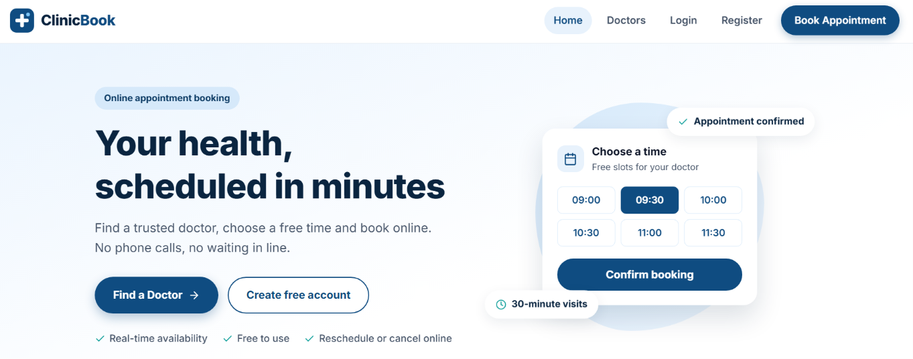
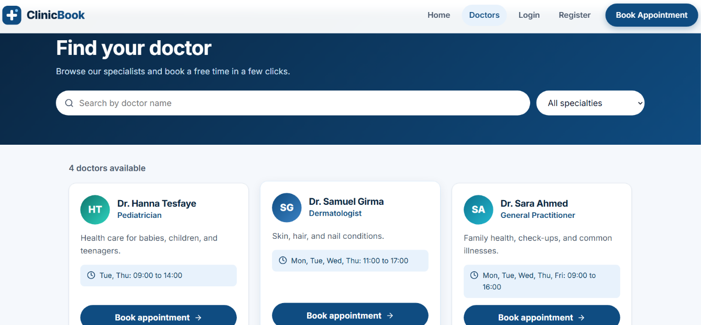
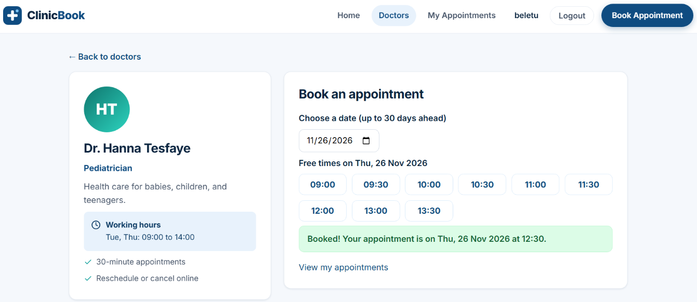
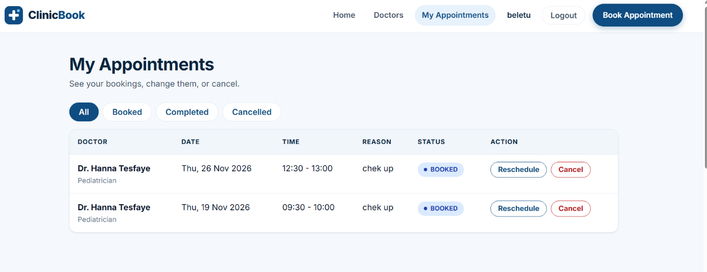
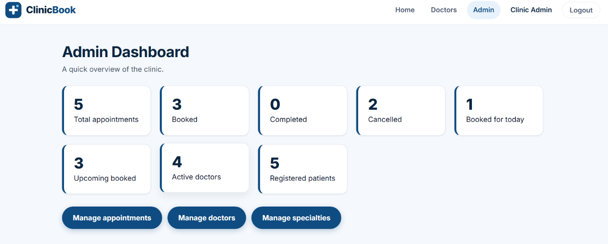

# ClinicBook

A full-stack clinic appointment booking system. Patients browse doctors, see real free time slots and book, reschedule or cancel online. Administrators manage doctors, working hours, specialties and appointments.

**Live demo:**https://clinicbook-nu.vercel.app/


**API health check:** https://clinicbook-api-b5tu.onrender.com

> The demo backend runs on a free plan, so the first request after a quiet period can take a little while.

**Demo patient account:** `patient@example.com` / `Patient1234`
(The administrator login is available on request.)

## Screenshots

| | |
|---|---|
|  |  |
|  |  |
|  | |

## Features

**Patients**
- Register, log in, and edit their profile
- Browse doctors, filter by specialty, and search by name
- See only the time slots that are truly free (30-minute slots, up to 30 days ahead)
- Book with a reason, reschedule, and cancel (up to 2 hours before the visit)
- View their own appointment history with status badges

**Administrators**
- Dashboard with live statistics
- Add and edit doctors, set weekly working hours, and deactivate or reactivate doctors
- Manage specialties
- List all appointments with filters (status, doctor, date), search and pagination
- Mark appointments as completed or cancelled

## Tech stack

| Layer | Technology |
|---|---|
| Frontend | React 19, Vite, React Router, Axios, plain CSS |
| Backend | Node.js, Express 5 |
| Database | PostgreSQL with Prisma ORM |
| Authentication | JWT and bcrypt, role-based access (PATIENT, ADMIN) |
| Security | Helmet, CORS, rate limiting, input validation |
| Hosting | Vercel (frontend), Render (API), Neon (database) |

## Appointment rules enforced by the server

- Only logged-in patients can book. Admins cannot.
- A doctor cannot be booked twice at the same time. A unique database key guarantees this, even if two patients click at the same moment.
- A patient cannot hold two active appointments at the same time.
- Slots must be inside the doctor's working hours, not in the past, and at most 30 days ahead.
- A cancelled appointment frees its slot.
- Patients cannot cancel or reschedule within 2 hours of the start.
- COMPLETED and CANCELLED are final statuses.
- Doctors with appointment history are deactivated, never deleted.
- Working hours cannot be changed in a way that would break existing bookings.
- All times use the clinic's time zone (default `Africa/Addis_Ababa`).

## Security

- Passwords are hashed with bcrypt and never returned by any endpoint.
- Admin accounts are created only by the seed script, never through registration.
- The role is read from the database on every request, not trusted from the token.
- Forged, expired and wrong-algorithm tokens are rejected.
- Rate limiting on the whole API, and a stricter limit on login and register.
- CORS only allows the frontend address. Request bodies are size limited.

## API overview

| Area | Endpoints |
|---|---|
| Auth | `POST /api/auth/register`, `POST /api/auth/login`, `GET` and `PATCH /api/auth/me` |
| Public | `GET /api/specialties`, `GET /api/doctors`, `GET /api/doctors/:id`, `GET /api/doctors/:id/slots?date=` |
| Patient | `POST /api/appointments`, `GET /api/appointments/me`, `PATCH /api/appointments/:id/cancel`, `PATCH /api/appointments/:id/reschedule` |
| Admin | `/api/admin/doctors`, `/api/admin/specialties`, `/api/admin/appointments`, `/api/admin/stats` |

A Postman collection is in [`docs/ClinicBook.postman_collection.json`](docs/ClinicBook.postman_collection.json).

## Project structure

```
clinicbook/
  backend/
    controllers/   request logic
    routes/        URL to controller mapping
    middleware/    authenticate, requireRole, rate limiters, error handling
    lib/           validation, dates and slot rules, token helper
    prisma/        schema, migrations, seed script
    scripts/       automatic API check scripts
  frontend/
    src/
      pages/       screens (patient and admin)
      components/  navbar, footer, doctor card, slot picker, ...
      api/         Axios client and API calls
      context/     login state
  docs/            testing guide, Postman collection, screenshots
```

## Run it locally

Requirements: Node.js 20 or newer, PostgreSQL 15 or newer.

1. Create a database named `clinicbook`.
2. Backend:

```
cd backend
npm install
copy .env.example .env
```

Edit `.env` (database password, a long `JWT_SECRET`, and an `ADMIN_PASSWORD`), then:

```
npx prisma migrate deploy
node prisma/seed.js
npm start
```

3. Frontend (in another terminal):

```
cd frontend
npm install
npm run dev
```

Open http://localhost:5173.

## Environment variables (backend)

| Variable | Purpose |
|---|---|
| `DATABASE_URL` | PostgreSQL connection string |
| `JWT_SECRET` | At least 32 random characters |
| `JWT_EXPIRES_IN` | Token lifetime, for example `7d` |
| `FRONTEND_URL` | The exact frontend address allowed by CORS |
| `CLINIC_TIME_ZONE` | Clinic time zone (default `Africa/Addis_Ababa`) |
| `ADMIN_PASSWORD` | Used only by the seed script |
| `AUTH_RATE_LIMIT` | Optional. Login attempts per 15 minutes (default 10) |

Frontend: `VITE_API_URL` is the API address, for example `https://YOUR-API.onrender.com/api`.

## Tests

With the backend running, `npm run check:all` in `backend` runs automatic API checks for authentication, profile, admin management, booking rules, appointment management and security. See [`docs/TESTING.md`](docs/TESTING.md).

## Known limitations

- The login token is stored in `localStorage`. An httpOnly cookie would be safer but needs extra backend work.
- The "no two active appointments at the same time" rule for one patient is checked in code, not by the database.
- Doctors do not have their own login. Administrators manage doctor profiles.
- No online payments, SMS, or medical records. This is a demonstration project.

